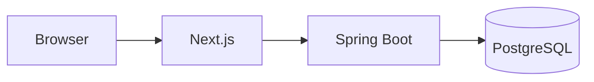

# My Showcase


**Live demo:** https://demos.coach-raffael.com/my-showcase — data resets nightly.

## What it shows

One paragraph: the problem, the product, and what is interesting to look at.

## Architecture

Short description plus a diagram (Mermaid works on GitHub):



## Stack

- Spring Boot 3 / Java 21, PostgreSQL
- Next.js, Tailwind CSS
- Playwright end-to-end tests, automated quality gate (tests, lint, secret scan, dependency and image scan,
  Lighthouse, accessibility)

## Run locally

```bash
docker compose up
```

## About

Built by [Raffael Hühnerschulte](https://coach-raffael.com) – IT made simple.
